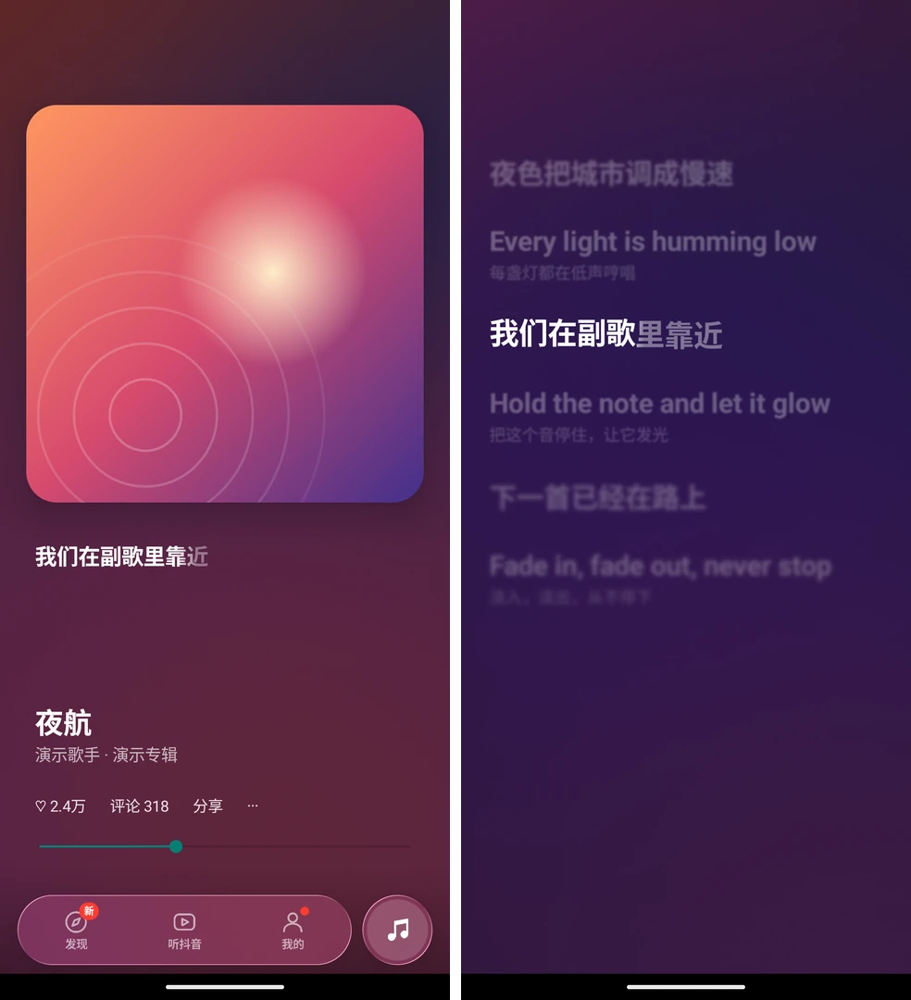
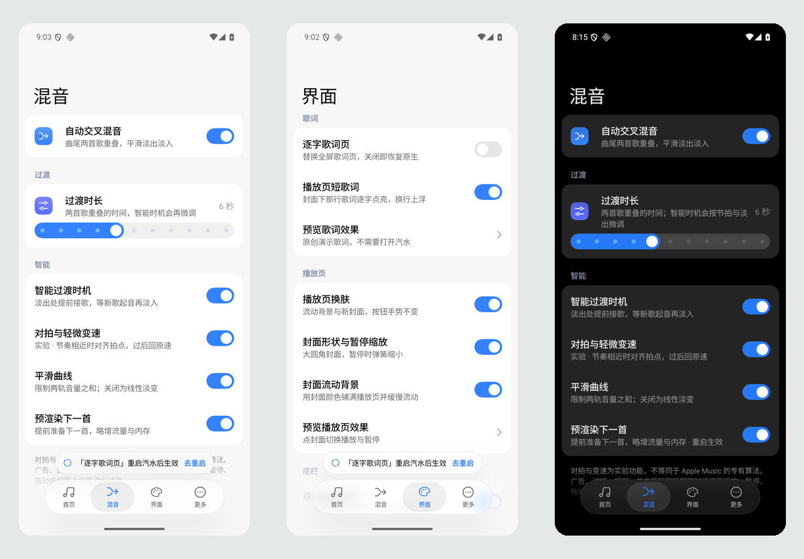

# 叠拍 FizzFade

叠拍是汽水音乐的 LSPosed 美化与性能优化模块。封面颜色铺进播放页，歌词跟着人声逐字亮起，底部导航换成一条悬浮玻璃栏。原来「汽水 AutoMix」里的自动接歌也在，外观和混音可以分开用。

目前只适配 **汽水音乐官网版 21.6.0（100216030）**。手机需要 Android 9 或更高版本，以及支持传统 Xposed API 82 的 LSPosed。旧版汽水 AutoMix 可以直接覆盖安装。

[下载汽水音乐 21.6.0（官方 APK）](https://lf9-apk.ugapk.cn/package/apk/luna/8986_100216030/luna_43074760a_v8986_100216030_8c8e_1794228360.apk?v=1794228368) · [下载叠拍模块](https://github.com/Beicho/FizzFade/releases/latest)



*图里是叠拍自带的播放页和歌词预览。打开「界面」，点「预览播放页效果」或「预览歌词效果」就能试。*

## 播放页美化

按下暂停，圆角封面会轻轻缩小，继续播放时再弹回来。封面下方可以留一行短歌词。想把页面收拾干净，歌名旁的标签、关注按钮、活动挂件和金币入口都能单独隐藏。

点进全屏歌词，正在唱的那一行会放大，前后几行逐渐变暗。歌里有逐字时间就逐字亮起，只有逐行时间就整行高亮。打开「点歌词跳转」，想重听哪句就点哪句。全屏逐字歌词页需要 Android 10 或更高版本。

底栏的玻璃胶囊会映出后面的页面。按住选中的气泡可以左右拖，也可以把「汽水」拆成右侧单独的圆钮。「福利」入口想不想留，由你自己选。

## 性能优化

- **连续切歌**时，离开屏幕的播放卡片和歌词页会解绑绘制监听，避免旧页面一直被占着。
- **滚歌词**时，排好的歌词行会缓存起来，逐字扫过时只重画正在唱的那行。封面流动背景单独按 30 fps 绘制，歌词动画可以按屏幕刷新率跑。
- **拖动玻璃底栏**时，气泡移动和缩放会复用已经画好的玻璃层。底下的页面变了，才重新采样背景。

「界面」里还有两个独立开关。「高刷新率」会向系统请求屏幕支持的最高刷新率；「实时模糊限速」把页头模糊限制在每秒最多 15 次。实际帧率和耗电取决于设备，这版还没有真机对比数据。

## 装好以后

1. 在 LSPosed 里启用「叠拍 FizzFade」，作用域勾选「汽水音乐」。
2. 到系统设置里强行停止汽水音乐，再打开它。回到叠拍首页看连接状态。
3. 在「界面」挑想用的效果。开关旁如果提示需要重启，强行停止并重开汽水就行。

<details>
<summary>查看模块设置截图</summary>



</details>

## 自动接歌

在「混音」里打开「自动交叉混音」，放一个歌单，让第一首自然播到结尾。上一首慢慢淡出时，下一首的前奏就进来了。默认重叠 6 秒，可以调到 2–12 秒。手动按下一首或拖进度条会取消这次过渡。

想听对拍效果，可以挑两首鼓点清楚、速度接近的歌，把「智能过渡时机」「预渲染下一首」和「对拍与轻微变速」都打开。接上时，下一首会稍微加速或放慢，过渡结束后回到原速。有些歌找不到稳定的拍点，这时只做淡入淡出。想知道刚才那次有没有对上，可以看首页的对拍次数。

试播、广告、视频、单曲循环和睡眠定时都按汽水原来的方式播放。预渲染会提前准备下一首，可能多用一些流量。

遇到问题可以[开个 issue](https://github.com/Beicho/FizzFade/issues)。写上 Android、LSPosed 和汽水的版本，再说说是哪一步出了问题。「更多」里可以导出日志，上传前记得看一眼里面的设备信息。

<details>
<summary>自己编译</summary>

装好 JDK 17、Android SDK Platform 36 和 Build Tools 36.0.0，设好 `JAVA_HOME` 和 `ANDROID_HOME`，在项目根目录运行：

```bash
./gradlew :app:assembleDebug
```

APK 在 `app/build/outputs/apk/debug/app-debug.apk`。调试包用本机证书签名，无法覆盖安装 Releases 里的版本。

跑测试用下面两条命令。手头有适配版本的官网 APK，也可以用 Python 3 检查播放器接口。

```bash
bash scripts/test.sh
bash scripts/test-host.sh
python3 scripts/verify_host.py /path/to/qishui.apk --output host-contract.json
```

要用自己的证书打包，设置 `SIGNING_KEY`（密钥库绝对路径）、`SIGNING_ALIAS` 和 `SIGNING_STORE_PASSWORD`。如果密钥和密钥库的密码不同，再设 `SIGNING_KEY_PASSWORD`。运行 `bash scripts/build-gradle.sh`，签名 APK 和校验文件会放在 `dist/` 下。

</details>

叠拍与汽水音乐官方无关。原创代码采用 [MIT 许可](LICENSE)。玻璃效果来自 Kyant 的 AndroidLiquidGlass，部分图标来自 Google Material Symbols，详见[第三方声明](docs/THIRD_PARTY_NOTICES.md)。
